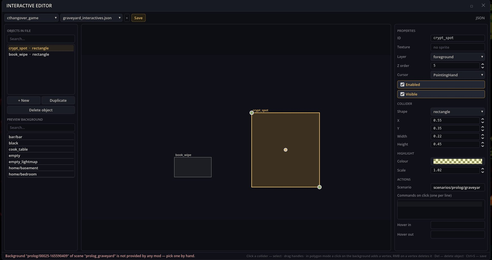

# インタラクティブエディター — シーン背景の上のクリックできるオブジェクト

インタラクティブエディターは、`interactive_base` のクリックできるオブジェクト（扉、宝箱、ランプ、見えない反応エリア）を、それが属する背景の上で編集します。各オブジェクトのコライダーをマウスで置いて形を整え、スプライト、レイヤー、カーソル、クリック時のコマンドを入力します。

## 開き方

ゲームのツールバーのハンマーボタン → **インタラクティブエディター**。

## オブジェクトの編集

1. MOD とインタラクティブのファイル（`interactives/*.json`）を選びます。**ファイル内のオブジェクト**に一覧が出て、**+ 新規**、**複製**、**オブジェクトを削除**で一覧を変えます。
2. プレビューには、そのオブジェクトを追加するシナリオのシーンの背景が表示されます（エディターがシナリオから探します）。**プレビューの背景**で別の背景を選べます。
3. コライダーをクリックして選び、ハンドルをドラッグします。**形**は矩形、円、多角形のいずれかで、多角形モードでは背景のクリックで頂点を追加し、頂点の右クリックで削除します（頂点は 3 つ以上）。
4. **プロパティ**: **ID**、**テクスチャ**（空なら見えないクリック領域）、**レイヤー**、**Z 順**、**カーソル**、**有効**、**表示**、**クリック時のコマンド（1 行に 1 つ）**。**ハイライト**（**色**、**拡大率**）は、カーソルの下でオブジェクトがどう光って大きくなるかを決めます。**アクション**の**シナリオ**はクリックで再生される `.scenario` ファイル、**カーソルが入ったとき**／**カーソルが出たとき**はカーソルが入る・出るときに実行されるコマンドです。
5. Ctrl+S でファイルを保存します。重複した ID や空の ID はメッセージとともに拒否されます。

保存したファイルは普通の MOD データです。実行中のゲームは MOD のホットリロード（保存後に自動、または Ctrl+Shift+R）で取り込み、オブジェクトはシナリオがシーンに追加したときに現れます。

## 依存関係

`tools_base`、`scenario_tools_base`、`interactive_base`、`ui_base`。
古い `editor_tools` パッケージは、この MOD をほかの作成用ウィンドウと一緒にインストールします。
