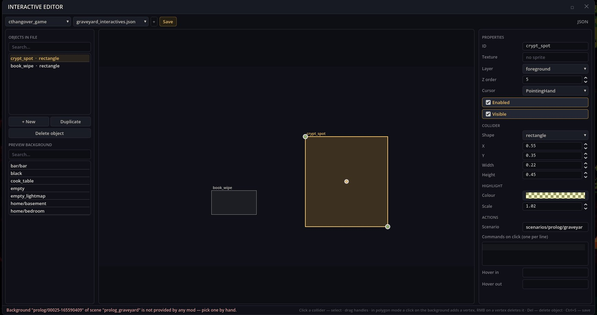

# 상호작용 에디터 — 장면 배경 위의 클릭할 수 있는 오브젝트

상호작용 에디터는 `interactive_base`의 클릭할 수 있는 오브젝트(문, 상자, 램프, 보이지 않는 반응 영역)를 그것이 속한 배경 위에서 편집합니다. 각 오브젝트의 충돌체를 마우스로 놓고 모양을 바꾸며, 스프라이트, 레이어, 커서, 클릭 명령을 채웁니다.

## 여는 방법

게임 툴바의 망치 버튼 → **상호작용 에디터**.

## 오브젝트 편집

1. 모드와 상호작용 파일(`interactives/*.json`)을 고릅니다. **파일 안의 오브젝트**에 목록이 나오고 **+ 새로 만들기**, **복제**, **오브젝트 삭제**로 목록을 바꿉니다.
2. 미리 보기는 그 오브젝트를 추가하는 시나리오가 속한 장면의 배경을 보여 줍니다(에디터가 시나리오에서 찾음). **미리 보기 배경**으로 다른 배경을 고를 수 있습니다.
3. 충돌체를 클릭해 선택하고 핸들을 끕니다. **모양**은 사각형, 원, 다각형 중 하나이며, 다각형 모드에서는 배경을 클릭하면 꼭짓점이 추가되고 꼭짓점을 오른쪽 클릭하면 지워집니다(꼭짓점 3개 이상).
4. **속성**: **ID**, **텍스처**(비우면 보이지 않는 클릭 영역), **레이어**, **Z 순서**, **커서**, **켜짐**, **보임**, **클릭할 때의 명령(한 줄에 하나)**. **강조**(**색**, **크기**)는 커서 아래에서 오브젝트가 어떻게 빛나고 커지는지 정합니다. **액션**의 **시나리오**는 클릭하면 재생되는 `.scenario` 파일이고, **마우스가 들어올 때**/**마우스가 나갈 때**는 커서가 들어오거나 나갈 때 실행되는 명령입니다.
5. Ctrl+S로 파일을 저장합니다. 중복되거나 빈 ID는 메시지와 함께 거부됩니다.

저장한 파일은 평범한 모드 데이터입니다. 실행 중인 게임은 모드 핫 리로드(저장 후 자동, 또는 Ctrl+Shift+R)로 이를 받아들이고, 오브젝트는 시나리오가 장면에 추가할 때 나타납니다.

## 의존성

`tools_base`, `scenario_tools_base`, `interactive_base`, `ui_base`.
예전 `editor_tools` 패키지는 이 모드를 다른 제작 창과 함께 설치합니다.
