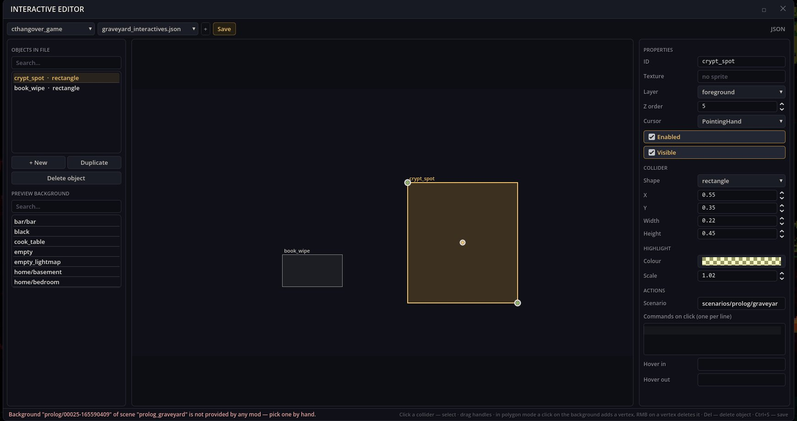

# 交互编辑器 —— 场景背景上的可点击对象

交互编辑器在对象所属的背景上编辑 `interactive_base` 的可点击对象——门、箱子、灯、隐形热区。你用鼠标放置每个对象的碰撞体并调整形状，再填写它的精灵、图层、光标和点击命令。

## 打开方式

游戏工具栏上的锤子按钮 → **交互编辑器**。

## 编辑对象

1. 选择模组和交互物文件（`interactives/*.json`）。**文件中的对象**列出其中的对象；**+ 新建**、**复制**和**删除对象**修改列表。
2. 预览显示添加该对象的剧本所属场景的背景（编辑器会在剧本中查找）；**预览背景**可以换一个。
3. 点击碰撞体选中它并拖动手柄。**形状**可以是矩形、圆形或多边形；多边形模式下点击背景添加顶点，右键点击顶点删除它（至少三个顶点）。
4. **属性**：**ID**、**纹理**（留空表示隐形的可点击区域）、**图层**、**Z 顺序**、**光标**、**启用**、**可见**，以及**点击时的命令（每行一条）**。**高亮**（**颜色**、**缩放**）设定对象在光标下如何发光和放大。在**动作**中，**剧本**是点击时播放的 `.scenario` 文件，**鼠标移入**/**鼠标移出**是光标进入或离开时执行的命令。
5. Ctrl+S 保存文件。重复或空的 ID 会被拒绝并提示。

保存的文件就是普通的模组数据。运行中的游戏通过模组热重载载入它（保存后自动进行，或按 Ctrl+Shift+R），对象在剧本把它们加入场景时出现。

## 依赖

`tools_base`、`scenario_tools_base`、`interactive_base`、`ui_base`。
旧的 `editor_tools` 包会把这个模组和其他创作窗口一起安装。
